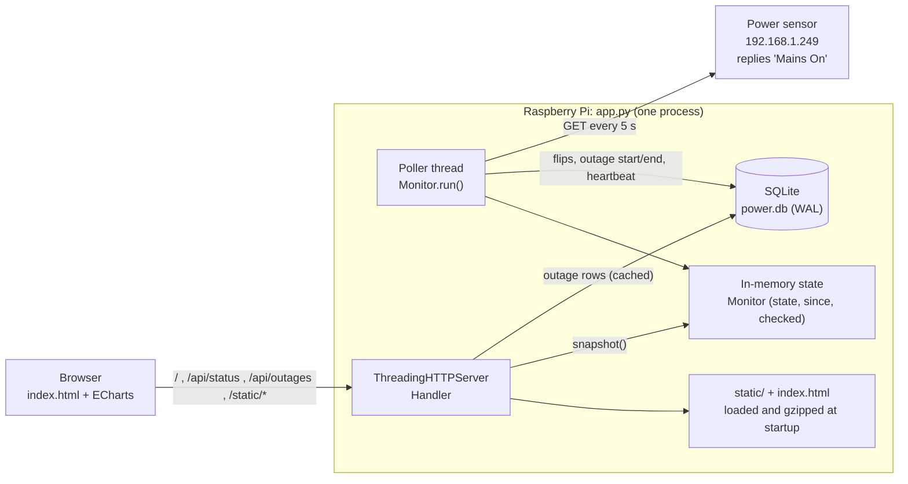
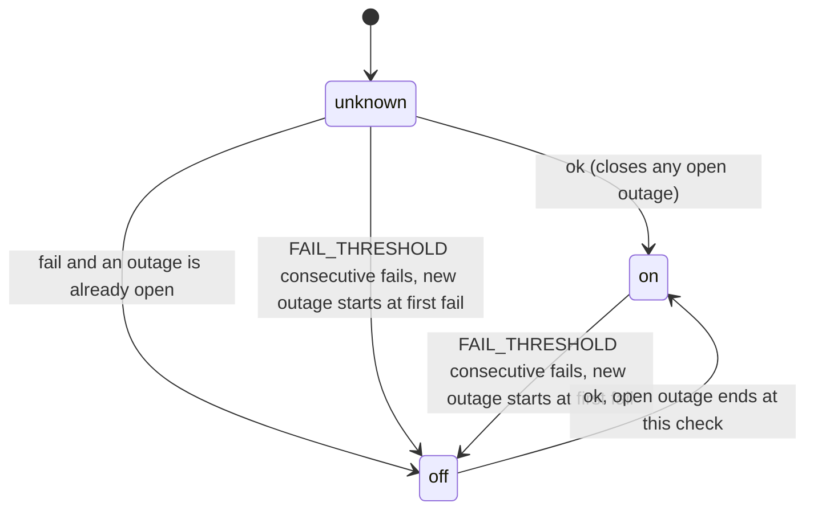

# Architecture

Power Status is a single Python process on a Raspberry Pi. It polls a mains-power
sensor on the LAN, keeps a lossless history in SQLite, and serves a dashboard that
community members open on their phones.

## Goals and constraints

| Constraint | Consequence |
|---|---|
| Raspberry Pi 2-class board: 4× Cortex-A7 @ 900 MHz, ~900 MB RAM, SD card | Standard library only, one process, very few disk writes |
| Python 3.10 on Raspberry Pi OS | No `pip install`; nothing newer than 3.10 is used |
| Many people check the page during an outage, often on cheap phones over mobile data | Status renders from the first response; charts load afterwards and only when scrolled into view |
| Historic data must never lose granularity | Raw sensor flips and outages are stored to the second and never aggregated or pruned; all aggregation happens at read time |

## Component overview



| File | Role |
|---|---|
| `app.py` | Everything server-side: config loading, `Store` (SQLite), `Monitor` (poller and state machine), `App` (page rendering, caches), HTTP handler, `main()` |
| `config.ini` | All settings (INI). Read once at startup; see *Configuration* below |
| `index.html` | The frontend's CSS, markup and rendering JS (text formatting, DOM, chart options). Server-side placeholders: `{{SITE_NAME}}`, `{{BOOT}}` and `{{CORE_JS}}` |
| `static/core.js` | Pure data logic (bucketing, stats, chart data) with no DOM or clock access. Inlined into the page by the server and `require()`d by the Node tests |
| `tests/` | Backend, frontend logic and browser smoke tests. See [TESTING.md](TESTING.md) |
| `static/echarts.min.js` | Trimmed ECharts 5.6.0 bundle (line, bar, heatmap and custom charts; grid, tooltip, slider data-zoom, visual-map, calendar and mark-area components; canvas renderer) |
| `tools/echarts/` | `package.json` and `entry.js` that build the bundle. Only needed to change chart types; the Pi never needs Node |
| `powersensor.service` | systemd unit (runs `app.py --config …/config.ini`) |

## Threads

- **Main thread** runs `ThreadingHTTPServer.serve_forever()`. Each request gets a
  short-lived daemon thread.
- **Poller thread** (`Monitor.run`) loops: check the sensor, record the result, then
  sleep for the rest of `POLL_INTERVAL`. The sleep is `Event.wait`, so shutdown is
  immediate.
- `SIGTERM`/`SIGINT` set the stop event and call `server.shutdown()` on a helper
  thread, which is required by `serve_forever()`. Shutdown deliberately does **not**
  close an open outage.

Shared state is protected by two locks:

- `Store.lock` serialises all access to the single SQLite connection.
- `Monitor.lock` guards the in-memory status.

Writes are rare, so contention is negligible.

## Configuration

`main()` reads one INI file before anything else starts: `--config PATH`, or
`config.ini` next to `app.py`. It uses Python's `configparser` because Python 3.10
has no TOML reader. The file has four sections, and each key maps to one
module-level setting:

| Section | Keys → setting |
|---|---|
| `[sensor]` | `url` → `SENSOR_URL`, `match` → `SENSOR_MATCH`, `poll_interval` → `POLL_INTERVAL`, `request_timeout` → `REQUEST_TIMEOUT`, `fail_threshold` → `FAIL_THRESHOLD` |
| `[monitor]` | `heartbeat_interval` → `HEARTBEAT_INTERVAL`, `gap_threshold` → `GAP_THRESHOLD` |
| `[storage]` | `db_path` → `DB_PATH` (relative paths resolve against the config file's folder) |
| `[server]` | `host` → `HOST`, `port` → `PORT`, `site_name` → `SITE_NAME` |

- **Defaults:** the module-level settings hold the built-in defaults.
  `load_config()` returns only the keys the file sets, and `apply_config()` overrides
  those.
- **Schema:** `CONFIG_SCHEMA` gives each key's type and validity check. Unknown
  sections or keys, `[DEFAULT]`, wrong types and out-of-range values raise
  `ConfigError`.
- **Bad config:** `main()` logs the error and exits with code **2**. The service unit
  sets `RestartPreventExitStatus=2`, so a broken file stops the service instead of
  restart-looping.
- **No file:** with no `--config` and no default file, the app warns and runs on
  defaults. An explicit `--config` path that doesn't exist is an error.
- **No other sources:** there's no reload signal and no environment-variable
  override, so the running settings are always exactly what was in the file at start.

## Sensing and the state machine

`check_sensor()` makes one HTTP GET with a `REQUEST_TIMEOUT` (`request_timeout`,
default 3 s). It reads at most 512 bytes and checks for `SENSOR_MATCH` (`match`,
default `Mains On`, compared
case-insensitively). Any exception, timeout, non-2xx reply or different text counts
as **not ok**. The sensor goes offline when mains is absent, so "unreachable" means
"no power".

`Monitor.record(ok, ts)` runs once per check:



- **Debounce:** an outage needs `FAIL_THRESHOLD` (`fail_threshold`) failures in a
  row (default 3, about 15 s), and is backdated to the first failed check. One
  success ends it.
- **`since`:** when on, the end of the most recent outage (or `tracking_since` if
  there has never been one). When off, the open outage's start.
- **Raw readings:** whenever `ok` differs from the previous check, a row goes into
  `readings`. This happens before and independently of the debounce, so blips shorter
  than the threshold are kept.
- **Heartbeat:** every `HEARTBEAT_INTERVAL` (60 s), `meta.alive` is set to now.

### Monitor downtime (the Pi itself was off)

On startup, `Monitor.__init__` reads `meta.alive`. If there is no open outage and the
last heartbeat is older than `GAP_THRESHOLD` (180 s), it opens an outage starting at
the last heartbeat with `inferred = 1`. The first successful check closes it, and the
UI labels it "start time approximate". This covers the common case where the Pi lost
power together with the mains.

## Data model

SQLite file `power.db`, opened in WAL mode with `synchronous=NORMAL`. The schema is
created with `CREATE … IF NOT EXISTS` at every start, so new tables appear
automatically on upgrade.

```sql
-- One row per outage. The source for every chart.
outages(id INTEGER PRIMARY KEY,
        start INTEGER NOT NULL,           -- unix seconds
        end INTEGER,                      -- NULL while ongoing (at most one open row)
        inferred INTEGER NOT NULL DEFAULT 0)   -- 1 = start approximated from heartbeat
INDEX outages_end ON outages(end)

-- Raw sensor log: one row per change of check result. Never aggregated or pruned.
readings(ts INTEGER NOT NULL,             -- unix seconds of first check with this result
         ok INTEGER NOT NULL)             -- 1 = 'Mains On' received, 0 = no/bad reply
INDEX readings_ts ON readings(ts)

-- Small key/value store
meta(k TEXT PRIMARY KEY, v TEXT NOT NULL)
--   tracking_since  first time the app ever ran (unix s); start of history
--   alive           last heartbeat (unix s); used to detect monitor downtime
```

**Why it never loses data:** only events are stored, never samples or summaries.
Between two `readings` rows the result was constant, so the table reconstructs the
sensor result at every poll losslessly while writing only on changes. `outages` is
the debounced interpretation of the same signal. Per-day totals, heatmaps and uptime
are all computed at read time, in the browser.

**Write volume:** one row per flip, two writes per outage, and one `meta` upsert per
minute. A year with three outages a day is roughly 2–3 k rows per table, well under
1 MB.

## HTTP interface

| Route | Response | Cache-Control |
|---|---|---|
| `GET /` | `index.html` with `{{BOOT}}` replaced by JSON: `status` (a `/api/status` snapshot), `outages` (all rows), `echarts` (versioned script URL) | `no-store` |
| `GET /api/status` | `{state, since, checked, now, tracking_since, poll, v, timezone, utc_offset, since_local, checked_local, now_local}` (example below) | `no-store` |
| `GET /api/outages?days=N` | `{days, outages: [[start, end\|null, inferred], …]}`, newest first. `days=0` returns all (capped at 20 000 rows) | `no-store` |
| `GET /api/readings?from=&to=` | `{from, to, readings: [[ts, ok], …]}`, oldest first; defaults to the last 24 h, capped at 100 000 rows | `no-store` |
| `GET /static/<file>` | Files from `static/`, read and gzip-9 compressed once at startup | `public, max-age=31536000, immutable` |
| `GET /healthz` | `ok`. Proves the HTTP server is up, **not** that polling works | `no-store` |

Notes:

- **Timestamps:** all of them are unix seconds, which identify an exact moment
  whatever the time zone. The dashboard converts them to each visitor's local time.
- **Time zone fields:** for other clients and for humans, `/api/status` also reports
  the Pi's time zone and the main moments as local ISO 8601 times with the UTC offset
  included:
  - `timezone` is the IANA name, read from `TZ`, `/etc/timezone` or
    `/etc/localtime`. If none of those exist, it falls back to an abbreviation such
    as `IST`.
  - `utc_offset` is the offset right now. It can change with DST in zones that use it.
  - `checked_local` is `null` before the first check.

  ```json
  {"state": "off", "since": 1792556598, "checked": 1792561066, "now": 1792561071,
   "tracking_since": 1792508266, "poll": 5.0, "v": 3,
   "timezone": "Asia/Kolkata", "utc_offset": "+05:30",
   "since_local": "2026-10-21T09:53:18+05:30",
   "checked_local": "2026-10-21T11:07:46+05:30",
   "now_local": "2026-10-21T11:07:51+05:30"}
  ```
- `v` in `/api/status` is `Store.version`, an in-memory counter bumped on every
  outage insert or update. Clients reload outages when it changes.
- Responses over 512 bytes are gzipped when the client accepts it. Dynamic responses
  are compressed per request; static files use the bytes compressed at startup.
- The ECharts URL carries `?v=<sha1 of static files>`, so a new bundle busts the
  one-year browser cache automatically.
- Per-request logging is disabled to keep journald and the SD card quiet. Only state
  changes are logged.

### Server-side caching

`App.outages(days)` caches query results keyed by
`(days, Store.version, current minute)`. Any outage change invalidates the entry
immediately; otherwise it is reused for up to a minute. Pages and status snapshots
are cheap and are not cached.

## Frontend

No framework or build step. Two scripts are inlined into the page: `static/core.js`
(exposed as `PS`) holds all data logic as pure functions that take `now` as an
argument, which keeps them unit-testable. The page script handles formatting, the
DOM and ECharts options. Only the ECharts bundle is a separate download.

**Load sequence**

1. The HTML arrives with the boot JSON embedded. The script renders the status card,
   stat tiles and outage list straight away, so the first meaningful paint needs only
   that one request.
2. It then injects `<script async src=static/echarts.min.js?v=…>`. When that loads,
   it creates the range-slider chart and draws whichever charts are on screen.
3. An `IntersectionObserver` (300 px margin) draws each chart only when it nears the
   viewport. Charts that are off screen are marked dirty and redrawn when they come
   back.

**Shared time window**

`W = {from, to, live}` drives the stats, all eight charts and the list.

- **Preset buttons** (3h / 12h / 24h / 7d / 30d / 90d / All; **3h is the default**)
  set `W` and move the slider. The choice is remembered in `localStorage` (key
  `range-h`, in hours).
- **Dragging the slider** (an ECharts slider data-zoom over the full history, whose
  shadow shows daily downtime) sets a custom `W`. Charts redraw 150 ms after the drag
  stops; stats and the list update immediately.
- **`live` windows** (ending within the last hour) slide forward as time passes.

**Aggregation**

Every chart works from the same in-memory list of outage rows:

- **Window clipping:** `overlap(outage, a, b)` gives the seconds an outage overlaps
  a period.
- **Bucket size:** periods are 15 minutes for windows up to 6 hours, hours up to 2
  days, and local calendar days beyond that. Sub-day periods follow the local clock,
  not UTC, which matters in UTC+5:30. Day steps use `Date.setDate`, so DST is
  handled. Chart titles and subtitles name the current size ("Outages per hour",
  "Share of each 15 minutes with power").
- **The current period** is still in progress, so tooltips mark it "(so far)". During
  an ongoing outage its uptime is correctly 0%.
- **Ongoing outages** use the current time as their end.

| Chart | What it shows |
|---|---|
| Power on/off | Step line plus red bands for outages. 300 sample points are added so the tooltip works anywhere along the line |
| Outages per day / hour / 15 minutes | Bars of downtime per bucket and a line of outage starts per bucket. Tapping a bucket filters the list |
| Outage timeline | Custom series: one row per day (latest 120), a block from start to end time-of-day; outages crossing midnight are split |
| 15-minute / Hourly / Daily uptime trend | Title follows the bucket size. Share of each bucket (15 minutes, hour or day) with power, measured only over time since tracking started and up to now |
| Calendar | Whole months covering the window (up to about a year), coloured by daily downtime |
| Weekly pattern | Heatmap of downtime minutes by weekday × hour |
| When outages start | Count of outage starts by hour of day |
| How long outages last | Counts in < 5 m, 5–30 m, 30 m–2 h and > 2 h groups |

**Live updates**

- **Status:** `/api/status` is polled every 10 s, only while the tab is visible, and
  immediately when the tab becomes visible again.
- **Outages:** reloaded when `v` or `state` changes, or after 5 minutes.
- **Status card:** ticks every second on the client. A clock-skew offset
  (`server.now − Date.now()`) keeps durations right on phones with wrong clocks.
- **Stale or unreachable data:** if the last check is older than max(30 s, 6 × poll)
  the card shows "Status unavailable". It shows the same if the status request itself
  fails.

**Theming:** colours are CSS custom properties with a `prefers-color-scheme: dark`
override. Charts read them at draw time and redraw when the scheme changes.

**Phone layout (≤ 640 px)**

The same page switches to an app-style layout using CSS alone; there is no separate
mobile page:

- **Tabs:** a bottom tab bar (Now · Trends · Patterns · History) shows one topic at a
  time.

  | Tab | Shows |
  |---|---|
  | Now | Status card, 4 key stats ("More stats" reveals the other 4), the on/off chart, the 3 latest outages |
  | Trends | Outages per period, outage timeline, uptime trend |
  | Patterns | Calendar, weekly pattern, start hours, durations |
  | History | The outage list |

- **How sections are hidden:** each section has a `data-tab` attribute, and
  `body[data-tab=…]` rules hide the others. Elements without `data-tab` (status card,
  presets, footer) show on every tab.
- **Tab links:** the current tab lives in the URL hash (`#trends`), so the phone's
  Back button moves between tabs and a link can open a specific tab. On desktop the
  hash has no effect; every section stays visible.
- **Pinned status:** outside the Now tab, the status card collapses into a slim bar
  pinned to the top, so the current state is always on screen.
- **Range controls:** presets use short labels. The drag slider is folded behind a
  ⇔ "Custom" button and is resized when it opens.
- **Lazy drawing:** charts on hidden tabs aren't drawn until their tab is opened (the
  same `IntersectionObserver` lazy-draw), and charts are resized when a tab is shown.
- **Tap a period:** in "Outages per …", tapping a bar switches to History filtered to
  that period.
- **iPhone edges:** `viewport-fit=cover` and `env(safe-area-inset-bottom)` keep the
  tab bar clear of the home indicator.

## Failure modes

| Situation | Behaviour |
|---|---|
| Mains off | Sensor unreachable → outage after about 15 s |
| Wi-Fi router off while mains is on | Indistinguishable from mains off, so it is **recorded as an outage**. Put the router on a UPS |
| Pi loses power or reboots | Gap longer than 3 minutes → inferred outage from the last heartbeat until the first good check |
| App crashes | systemd restarts it after 3 s. An open outage stays open and continues |
| Short blip (< threshold) | Recorded in `readings` only, not as an outage |
| Pi clock wrong at boot (no RTC; time is restored from the last saved value until NTP syncs) | Timestamps written before sync can be off. See *Clock* in `ADMINISTRATION.md` |
| Visitor's browser can't load ECharts | Status, stats and list still work; chart areas show "Loading chart…" |

## Design decisions

- **Standard library only.** Nothing to install or break on the Pi, and the Python
  part has no supply-chain surface. `http.server` is enough for read-only JSON and a
  few pages.
- **Single SQLite connection plus a lock.** Simpler than a connection pool and plenty
  fast for this workload. WAL keeps readers from blocking the writer.
- **Store events, not samples.** Lossless for a binary signal and kind to the SD card.
- **Aggregate in the browser.** The whole outage history is small (tens of KB per
  year). Sending it once lets the slider re-slice every chart instantly with no
  server round trips and no summary tables that could drift from the raw data.
- **Trimmed ECharts, self-hosted.** It is the only library with step lines, a range
  slider, heatmaps, a calendar and custom timelines built in. Tree-shaking cuts it to
  about 200 KB gzipped, cached for a year. Self-hosting keeps the dashboard working on
  the LAN when the internet is down.
- **Status first, charts later.** The question most visitors have ("is power on?") is
  answered from the first response, before any JS library loads.

## Limits

- **Visitors:** sized for a community, from tens to a few hundred people. Each open
  tab makes one small request every 10 s. On this hardware the server should manage
  well over 100 simple requests/s; put a CDN such as Cloudflare in front for more.
- **History size:** `/api/outages` returns at most 20 000 rows, enough for decades at
  realistic outage rates.
- **One sensor per process.** For several sensors, run one instance per sensor with
  different config files (different `port` and `db_path`), each passed with
  `--config`.
